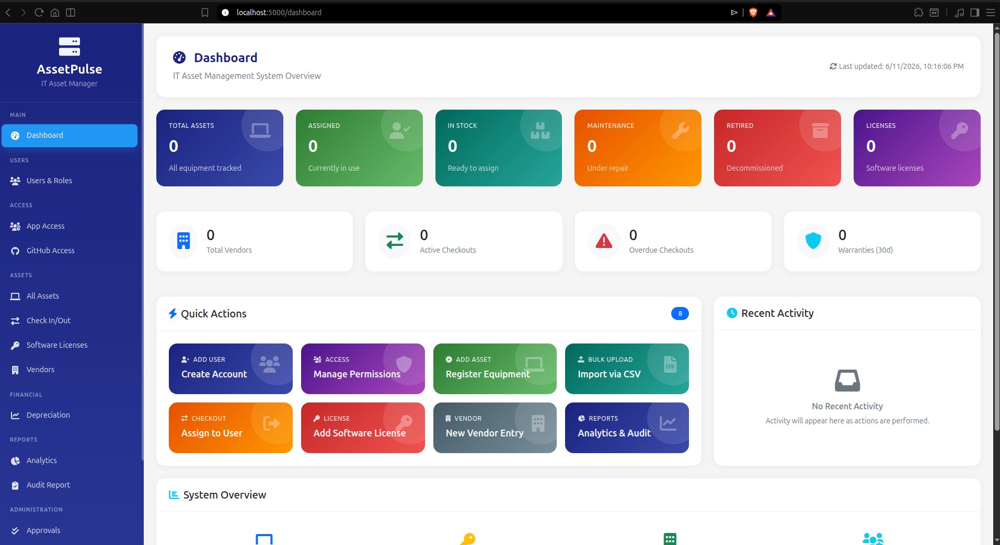
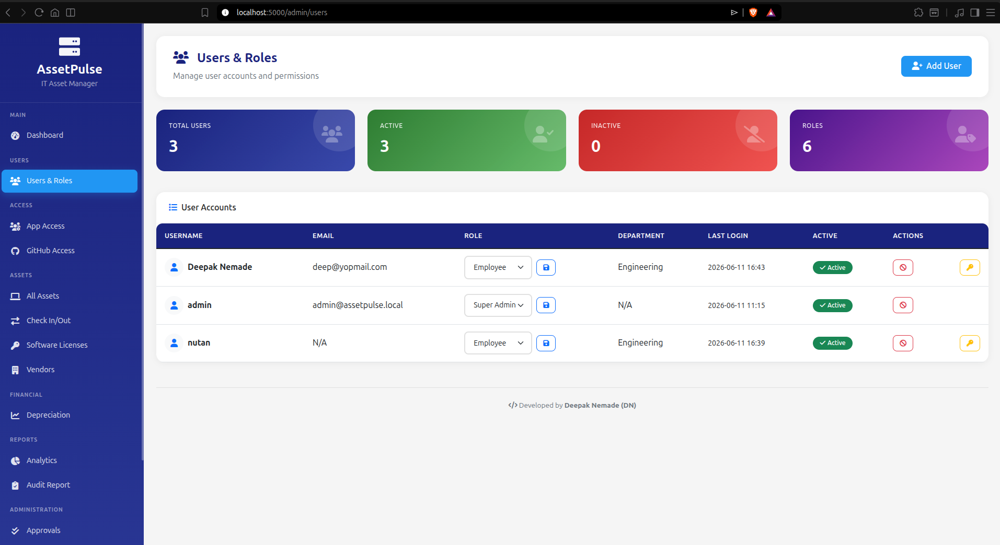
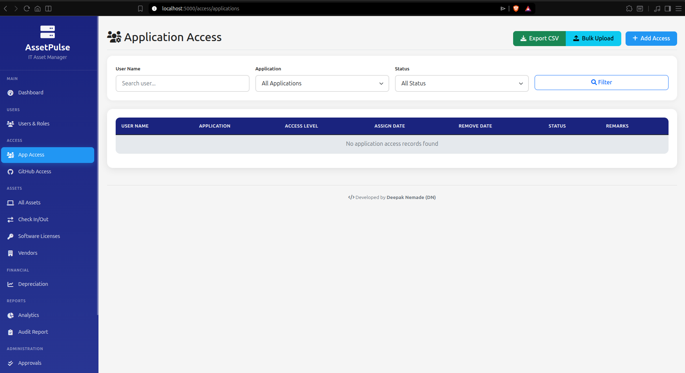
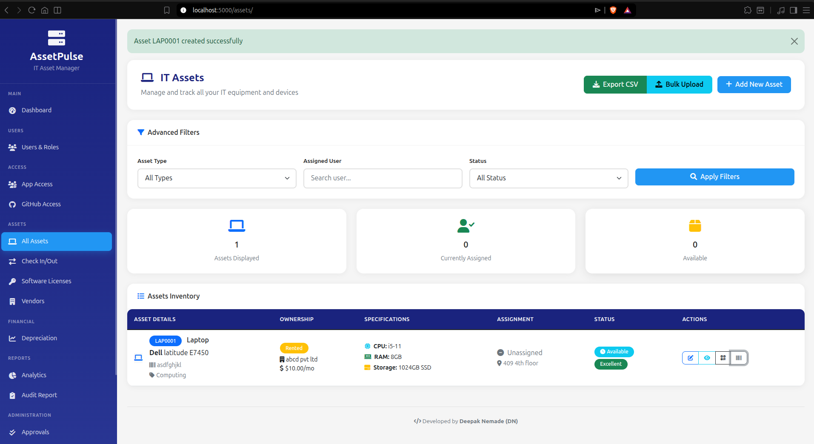
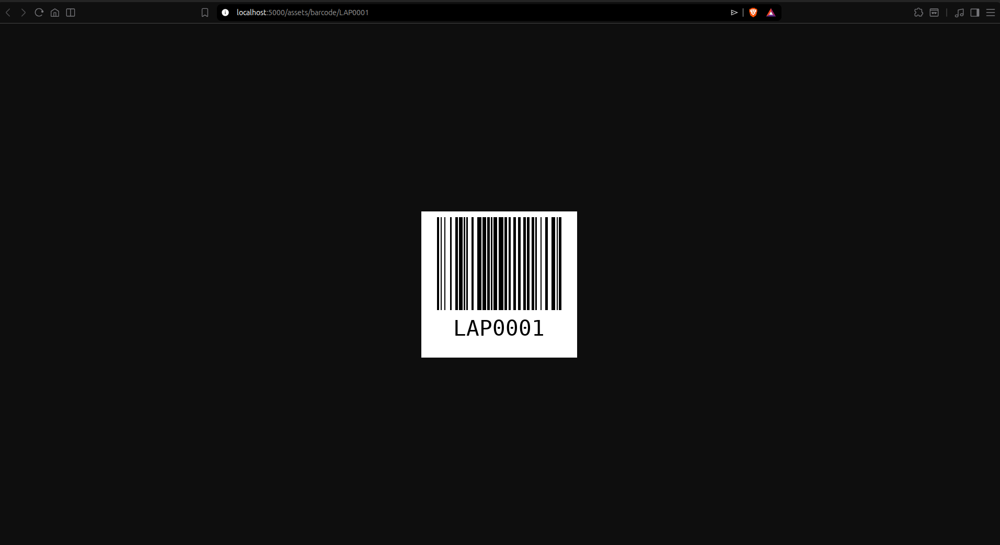
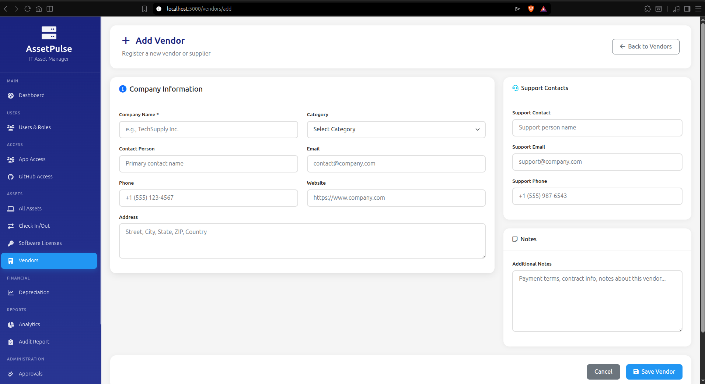
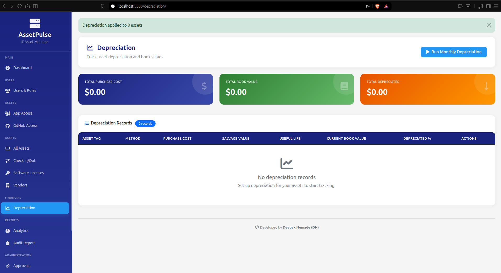
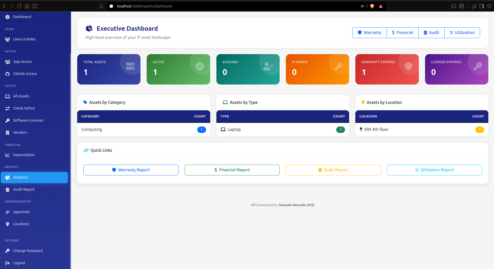
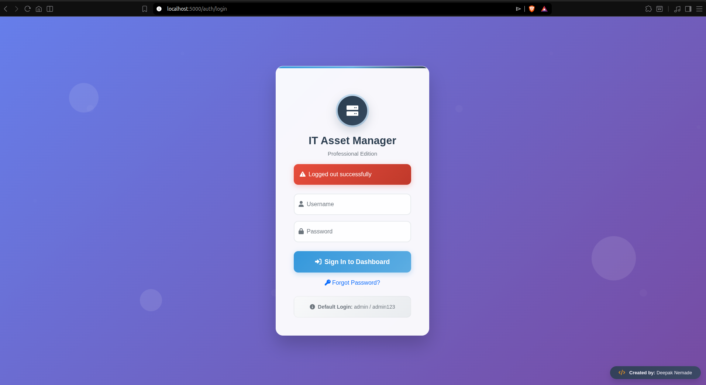

# 🏢 IT Asset Manager - Professional Edition

[](https://python.org)
[](https://flask.palletsprojects.com/)
[](https://docker.com)
[](LICENSE)

> **A comprehensive web-based IT Asset Management System designed for Network and System Administrators to efficiently track, manage, and monitor IT assets, user access permissions, and organizational resources.**

## 👨‍💻 **Author**

**Deepak Nemade**  
*Network & System Administrator | IT Asset Management Specialist*

[](https://www.linkedin.com/in/deepak-nemade/)
[](https://github.com/DeepDN)

---

## 📸 **Screenshots**

| | |
|:---:|:---:|
|  |  |
|  |  |
|  |  |
|  |  |
|  | |

---

## 🚀 **Quick Start**

### **🐳 Docker Deployment**

```bash
# Clone repository
git clone https://github.com/DeepDN/it-asset-manager.git
cd it-asset-manager

# Configure environment
cp .env.example .env

# Start development environment
docker compose up -d

# Access: http://localhost:5000
# Username: admin | Password: admin123 (CHANGE IMMEDIATELY)
```

### **Production with Nginx**
```bash
docker compose -f docker-compose.prod.yml up -d
# Access: http://localhost
```

---

## 🔧 **Configuration**

Create a `.env` file for production settings:

```env
SECRET_KEY=your-super-secret-key-change-this
FLASK_ENV=production
DATABASE_URL=postgresql://user:pass@db:5432/it_asset_manager
```

---

## 📋 **Asset Types Supported**

- **Laptops** (LAP####), **Desktops** (DSK####)
- **Routers** (RTR####), **Switches** (SWH####), **Firewalls** (FWL####)
- **Smartphones** (MOB####), **Tablets** (TAB####)
- **Monitors** (MON####), **Projectors** (PRJ####), **Speakers** (SPK####)
- **Printers**, **Keyboards**, **Mice**, **Cables**, and more

---

## 🔍 **Troubleshooting**

```bash
# Check logs
docker compose logs app

# Rebuild without cache
docker compose build --no-cache

# Reset database (WARNING: Deletes all data)
docker compose down -v
docker compose up -d
```

---

## 📄 **License**

This project is licensed under the MIT License - see the [LICENSE](LICENSE) file for details.

---

*Created with ❤️ by [Deepak Nemade](https://www.linkedin.com/in/deepak-nemade/)*
